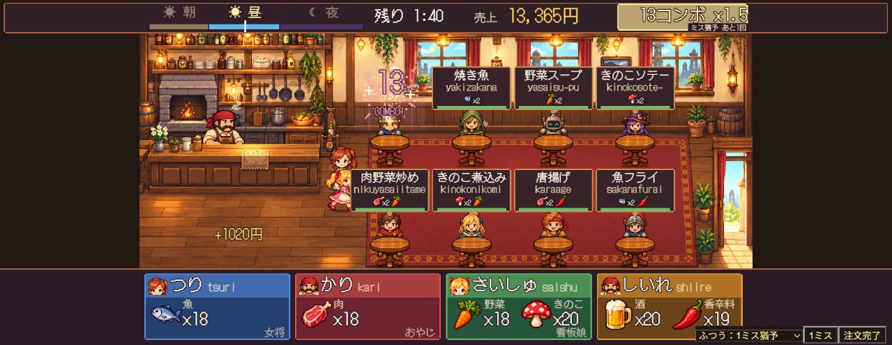

# コンボのミス猶予とWPM別素材バランス

初期在庫はこの記録の固定配分から[ランダム配分](starting-stock.md)へ追加調整しています。

ブランチ：`codex/combo-procurement-balance`。変更前はマージ済みの `7bd158d`。

## コンボ

- やさしい：注文完了まで2ミスを許容。3ミス目で途切れる。
- ふつう：1ミスを許容。2ミス目で途切れる。
- むずかしい：1ミス目で途切れる。
- 料理を出すと猶予が全回復。正しい1打鍵、打ち直し、材料不足の注文、調達出発・帰還では回復しない。
- 調達中のミスは従来通り営業のコンボを切らない。待たせすぎて客が帰ると、難易度によらずコンボが途切れる。
- 猶予内のミスも正確率には記録する。難易度選択と営業HUDに猶予を表示。

## 検証方法

WPMは5打鍵を1語とする標準値（WPM÷12＝打鍵/秒）。30・45・60・90・120 WPM、3難易度、4調達、各12シード、計720回。出題を読む時間0.2秒、ミス率4%を含む。10秒間のミニゲームを遊び、釣りの延長も最後まで計測。獲得量は最低持ち帰り保証を適用した帰還時の平均で、小数は複数回の平均値。

自動プレイは表示された候補を把握するボットであり、人間の判断や視線移動を完全に再現するものではない。素材が複数種類ある調達の合計数だけで優劣を決めず、レシピの必要量と3分間の営業でも比較した。

## 調達と料理の変更

- 釣り：小物5→4個。大物11個と連続入力は維持。狩りより長くなる延長時間を含めて調整。
- 狩り：小物2→3個。大物12個・3語は維持し、高WPMで小物も狙う価値を上げる。
- 採取：1回4個を維持。畑に野菜かきのこの片方しかなければ、次の安全な出題は不足側にする。毒の確率は難易度通り。
- 仕入れ：落札3→2個、ノーミスの追加1個は維持。酒・香辛料の2種類を一度に補充できる点を考慮。
- 主菜の魚・肉は2個、単品野菜・きのこも2個を使用。付け合わせや香辛料は主に1個。
- 初期在庫は魚6・肉6・野菜6・きのこ4・酒5・香辛料3。序盤の調達頻度が急に増えすぎないよう補正。
- 注文の素材アイコンに「×2」などの必要個数を表示。素材不足の判定と実際の消費量を一致させる。

## 通常難易度：調整前→調整後の平均獲得量

| WPM | 釣り | 狩り | 採取 | 仕入れ |
|---|---|---|---|---|
| 30 | 魚14.2 → 魚13.2 | 肉7.6 → 肉7.5 | 野菜5・きのこ3.3 → 野菜5・きのこ3.2 | 酒4.3・香辛料3.8 → 酒4.2・香辛料3 |
| 45 | 魚16 → 魚15 | 肉16 → 肉18 | 野菜9・きのこ4.3 → 野菜6.7・きのこ4.3 | 酒7.5・香辛料7.1 → 酒5.5・香辛料5.3 |
| 60 | 魚23.9 → 魚22.3 | 肉18.5 → 肉21.8 | 野菜12.7・きのこ4.6 → 野菜11.7・きのこ6.7 | 酒11.2・香辛料7.9 → 酒8.3・香辛料5.8 |
| 90 | 魚31.1 → 魚29.1 | 肉21.8 → 肉26.8 | 野菜20・きのこ10 → 野菜17.3・きのこ13 | 酒14.7・香辛料12.2 → 酒10.8・香辛料8.9 |
| 120 | 魚35.1 → 魚32.8 | 肉22.8 → 肉28.3 | 野菜26.7・きのこ12 → 野菜21.7・きのこ14.3 | 酒17.5・香辛料15.9 → 酒12.8・香辛料11.7 |

釣りの平均所要時間（30/45/60/90/120 WPM）：13.5 / 10 / 12.5 / 10.8 / 10.7秒。他の調達は各10秒。出発・帰還演出はそれぞれ0.9秒。

通常45〜120 WPMで、釣り÷狩りの秒あたり獲得量が0.8〜1.25の範囲、全難易度・全調達で90 WPMが30 WPMより25%以上効率よく調達できることを回帰テストで確認。

## 各料理の必要素材

| 料理 | 必要素材 | 価格 |
|---|---|---|
| 焼き魚 | 魚×2 | 120円 |
| 野菜スープ | 野菜×2 | 100円 |
| エール | 酒×1 | 80円 |
| きのこソテー | きのこ×2 | 110円 |
| 干し肉 | 肉×2 | 120円 |
| 肉野菜炒め | 肉×2・野菜×1 | 260円 |
| きのこ煮込み | きのこ×2・野菜×1 | 240円 |
| 唐揚げ | 肉×2・香辛料×1 | 230円 |
| 魚フライ | 魚×2・香辛料×1 | 230円 |
| 香草焼き | 魚×2・野菜×1 | 250円 |
| ハンターシチュー | 肉×2・野菜×2・きのこ×1 | 400円 |
| ピリ辛鍋 | 魚×2・きのこ×1・香辛料×1 | 400円 |
| 魚の酒蒸し | 魚×2・酒×1 | 260円 |
| 肉の黒エール煮 | 肉×2・酒×1 | 280円 |
| スパイスエール | 酒×2・香辛料×1 | 230円 |
| 荒野の大皿 | 肉×2・魚×2・野菜×2・香辛料×1 | 620円 |

## 確認

- 432件の自動テスト成功。本番ビルド成功。
- 3分間の営業を全難易度・複数シードで確認。初心者向け30 WPM相当の「やさしい」でも待ち時間切れをほぼ起こさず、調達と注文を続けられることを確認。
- 回帰テストはミス猶予の境界・回復条件、16料理すべての消費量、素材不足時の非消費、必要個数の表示を含む。
- 詳細な測定値：[変更前](procurement-before.json)／[変更後](procurement-after.json)。
- 再測定：PowerShellで `$env:VITE_PROCUREMENT_REPORT='1'` を設定し、`npx vitest run tests/procurement.balance.test.ts --silent=false` を実行するとJSONが出力される。

