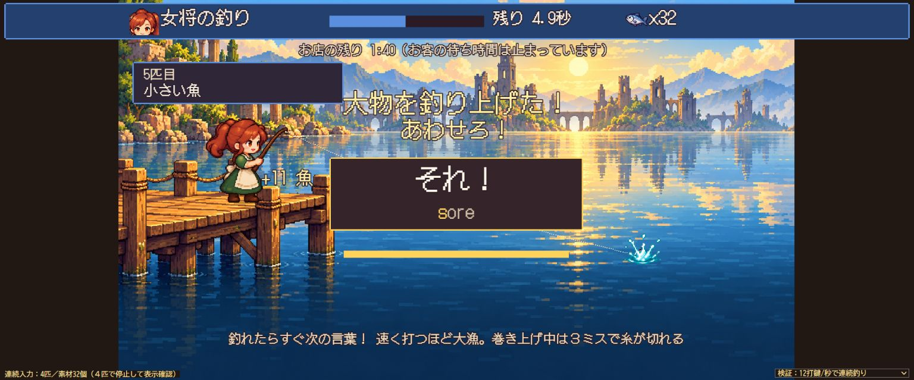
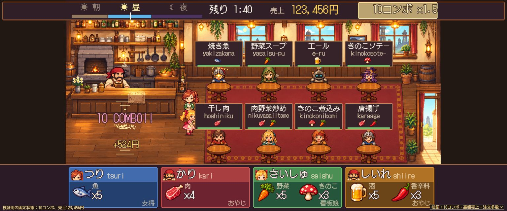

# 入力・難易度・釣りの改善

修正ブランチ：`codex/typing-flow-balance`

## 文字表示

- 日本語フォントをゲーム開始前に先読みし、初出の漢字で字体・幅が切り替わるのを防止。
- 同じ画面サイズの通知ではCanvasをリセットしない。
- 連続提供の通知は最新値に更新。売上、コンボ、警告を客席の注文から離して配置。
- 時間帯の通知は固定欄へ。上部の売上とコンボはそれぞれの幅に収める。

## 難易度

数値は朝／昼／夜の順。調達中は従来通り客の待ち時間を停止。

| 項目 | やさしい | ふつう | むずかしい |
|---|---|---|---|
| 来客間隔（秒） | 10.5 / 7.56 / 5.88 | 6 / 4.32 / 3.36 | 4.5 / 3.24 / 2.52 |
| 待ち時間（秒） | 66 / 66 / 57.2 | 36 / 36 / 31.2 | 27 / 27 / 23.4 |
| 釣りのあわせ猶予（秒） | 3.84 | 2.08 | 1.6 |
| 狩りの移動速度倍率 | 0.55 | 0.9 | 1.1 |
| 採取の表示時間倍率 | 1.8 | 1.15 | 0.95 |
| 毒きのこの出現率 | 4% | 10% | 17% |
| 仕入れライバル速度倍率 | 0.5 | 0.85 | 1.1 |
| 釣りの巻き上げ語句の最大打鍵数 | 5 | 6 | 8 |

3分間・毎秒2.5打鍵・ミス率4%・5シードの自動プレイで、やさしいは平均19皿、怒って帰る客は全シード0人。ふつうは平均1人、むずかしいは平均4人が怒って帰った。候補を即座に選ぶボットによる比較のため、人間の読解・判断時間は含まない。

## 釣り

釣り上げた直後から次のあわせを入力できる。演出から通常のあわせ表示へ切り替わっても、途中の入力は保持。あわせ・巻き上げの言葉を同じ位置に表示する。小物5個、大物11個、偶数匹目は大物、大物は3語、3ミスで糸切れ、最大5秒の大物延長は維持。

毎秒12打鍵で3難易度×5シードを実行し、全てで2匹を超え、毎秒3打鍵より多く調達できることを確認。

## コンボ・売上

3コンボから大きな数字、金色の光・粒子・HUDの強調と追加音。10コンボごとに粒子を増やし、上昇するファンファーレを再生。連続通知は重ねず更新し、入力する注文を隠さない。営業中と結果画面の売上に「円」を付加。

## 検証結果

- 自動テスト397件成功。型検査を含む本番ビルド成功。
- 通常のタイトル→難易度選択→営業→釣りをブラウザーのキー操作で確認。
- 検証用画面では、通常難易度・毎秒12打鍵で約5秒間に4匹、素材32個を獲得。そのまま次の合図を表示できることを確認。
- 注文8件、10コンボ、売上123,456円の固定状態で、注文・通知・売上・コンボの文字が重ならないことを確認。
- 画像は検証用状態を含む。

